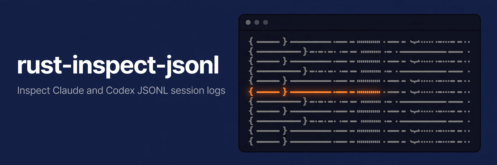

<p align="center">
  
</p>

<p align="center"><strong>Inspect Claude and Codex JSONL session logs from the command line</strong></p>

<p align="center">
  <a href="LICENSE"></a>
  <a href="Cargo.toml"></a>
  <a href="https://github.com/conao3/rust-inspect-jsonl/stargazers"></a>
</p>

<p align="center">
  <a href="#install-and-develop">Install</a> ·
  <a href="#grammar">Grammar</a> ·
  <a href="#streaming-exception">Streaming</a> ·
  <a href="#commands">Commands</a> ·
  <a href="#verification">Verification</a>
</p>

# rust-inspect-jsonl

`rust-inspect-jsonl` reads a Claude or Codex JSONL session log and turns each JSON line into a normalized event: line number, timestamp, event type, tool name, token usage, and payload kind and length.

The CLI takes input in the AWS CLI grammar: `rust-inspect-jsonl [global options] <command> <subcommand> [--parameter value ...]`.

```sh
rust-inspect-jsonl session inspect-session --session-log file://session.jsonl
cat session.jsonl | rust-inspect-jsonl session inspect-session --session-log file:///dev/stdin
```

The output is NDJSON, so you can pipe it into `jq`. See [`session inspect-session`](#session-inspect-session) for the event format.

## Install and develop

The repository ships a Nix flake with a dev shell for the Rust toolchain.

```sh
nix develop
cargo run -- session inspect-session --session-log file://session.jsonl
```

## Grammar

- Parameters are named `--kebab-case` options. The CLI takes no positional arguments.
- A value starting with `file://` names a file to read. Read stdin with `file:///dev/stdin`. `--session-log` reads its file line by line, so memory use stays flat for any log size. Any other value of `--session-log` is the log itself.
- Global options: `--output json|text|table` (default `json`), `--debug` (also reports each skipped line on stderr), `--version`.
- `help` works at each level: `rust-inspect-jsonl help`, `rust-inspect-jsonl session help`, `rust-inspect-jsonl session inspect-session help`.

Exit codes:

| Code | Meaning |
|------|---------|
| `0` | Success |
| `252` | Syntax or parameter error, including a `file://` path the CLI cannot open |
| `254` | The CLI cannot process the input: no non-empty line of `--session-log` is JSON |
| `255` | Other failures |

### Streaming exception

`session inspect-session` streams its result instead of printing one JSON document at the end:

- `--output json` writes NDJSON: one compact JSON object per parsed event as soon as the CLI reads its line, then one summary line.
- `--output text` and `--output table` render each line on its own.
- With exit code `254`, the CLI still writes the summary line before the error.

## Commands

### `session inspect-session`

```sh
rust-inspect-jsonl session inspect-session --session-log file://session.jsonl
```

Parameters:

- `--session-log`: the raw JSONL session log (use `file://<path>` or `file:///dev/stdin`).

Output: one event line per JSON line of the log, then a summary line. The CLI copies `Usage` from the log as is. `SkippedLines` lists the lines that are not JSON (or not UTF-8) with their parse error.

```json
{"LineNumber":1,"Timestamp":"2026-02-27T09:36:33Z","EventType":"assistant","ToolName":null,"Usage":{"input_tokens":123,"output_tokens":45,"cache_read_input_tokens":1000},"Payload":{"Kind":"text","Chars":320}}
{"ParsedLines":1,"SkippedLines":[]}
```

Keep only the events:

```sh
rust-inspect-jsonl session inspect-session --session-log file://session.jsonl | jq -c 'select(has("LineNumber"))' > events.inspect.jsonl
```

## Verification

```sh
nix develop -c cargo fmt --check
nix develop -c cargo check
nix develop -c cargo clippy --all-targets -- -D warnings
nix develop -c cargo test
```

## License

Apache-2.0. See [LICENSE](LICENSE).
